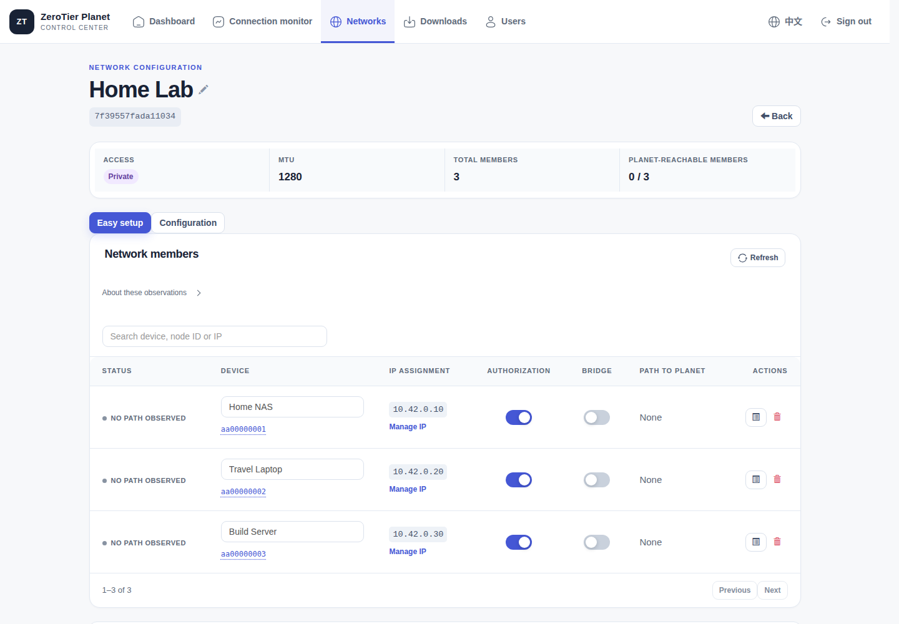

<div align="center">

# zerotier-planet-ms

### Your devices, miles apart. One private network.

Connect your NAS, laptop and cloud servers through an **encrypted virtual LAN**.

Host your own ZeroTier Planet and Controller. Manage access, authorization and addresses from your own console.

[](https://github.com/Csneer/zerotier-planet-ms/actions/workflows/image-build.yml) [](https://github.com/Csneer/zerotier-planet-ms/releases)

**[Get started](#get-started)** · **[See the console](#one-network-one-console)** · **[Compare options](#choose-the-network-that-fits)** · **[Operations guide](docs/operations.en.md)** · **[中文](README.md)**

</div>

<br>


<br>

## Take your private services with you

Away from home, your NAS still has its familiar virtual IP. On another network, your workstation is still an SSH connection away. Services at home and applications in the cloud can reach each other over the same private network.

`zerotier-planet-ms` is for individuals, home labs and small teams that want to **run their own ZeroTier infrastructure**. Once devices join a network and receive authorization, they can reach each other's services using virtual IPs. Keep your existing NAS interface, remote desktop client, Git tools, databases and applications—without publishing each service to the Internet.

| What you want to do | What the network enables |
| :--- | :--- |
| **Reach your NAS from anywhere** | Open its interface and sync files over a virtual IP, without a separate public port-forwarding rule for every service. |
| **Keep your workstation within reach** | Access SSH, RDP and development environments from your laptop. The target must be running, with the required service and firewall access enabled. |
| **Connect home, servers and cloud** | Link machines running the client across locations; add planned routes or gateways when you need to reach an existing subnet. |
| **Build a private team network** | Authorize devices centrally, assign addresses and organize test services, collaboration tools and shared resources by network. |

**Connect devices first; add subnets when needed.** Clients generally initiate connections and attempt direct paths using NAT traversal, with relaying available when network conditions prevent direct connectivity. On a direct path, application traffic travels between devices instead of all passing through your cloud server.

<br>

## Encrypted connections. Infrastructure you control.

**End-to-end encryption between devices.** Under ZeroTier's normal encrypted transport configuration, virtual network traffic is encrypted at one endpoint and decrypted at the other. It remains encrypted through a Root relay, which cannot read the application payload. Encryption and identity authentication come from the [ZeroTier protocol](https://docs.zerotier.com/protocol); this project brings self-hosted Roots, a Controller and day-to-day management together.

**Your authorization and network configuration.** Create networks, check node IDs, authorize devices and manage virtual addresses on your own Controller. Planet signing material, server identities, configuration and backups stay on infrastructure you operate.

**A public endpoint for the network, private access to services.** Your Root provides a reachable UDP endpoint. NAS devices and workstations offer their services through the virtual network, so every application does not need its own public-facing port.

“Encrypted LAN” means the **virtual network between ZeroTier endpoints**. It does not automatically encrypt the physical LAN behind a gateway or replace application authentication, SSH/HTTPS or host firewalls. See the [selection guide (Chinese)](docs/choosing-a-solution.md) for protocol boundaries and sources.

<br>

## One network, one console



<p align="center"><sub>Current main-branch UI · Isolated demo instance with fictional devices · No production data</sub></p>

**Keep everyday actions visible and open details when you need them.** Create networks, authorize members, change MTU and download Planet files in one place. Click a member to inspect its version, IPs, authorization and observed paths. Longer configuration and diagnostic views open in dialogs, keeping the page compact.

| Day-to-day management | When you need to investigate |
| :--- | :--- |
| Device aliases, member search, pagination and authorization switches | DIRECT / RELAY observations with separate service and probe perspectives |
| IPv4 / IPv6 address assignment, routes, DNS and MTU | Root address families, recent responses and Planet file consistency |
| Authenticated Planet downloads with SHA-256 verification | Clickable version and bridge notices with explanations and next steps |
| Chinese and English interfaces for desktop and mobile | Consistent backups, checked upgrades and recovery workflows |

Monitoring shows **evidence from a specific observation point**. Reachability to a Root does not prove that any two devices have a direct connection. Continue with the [client and path troubleshooting guide (Chinese)](docs/client-troubleshooting.md) when investigating.

<br>

## Start with a small cloud VM

**2 vCPU / 2 GiB is a practical starting point.** A small Linux VM from Alibaba Cloud or another provider can host your initial deployment. Use a prebuilt image to keep the machine's resources available for running services rather than compiling dependencies.

An isolated container test with a 2 vCPU / 2 GiB limit completed login, network creation, authorization, renaming and mobile UI workflows. A single memory sample at the end was approximately **69 MiB**. That demonstrates a lightweight management service, not a relay throughput guarantee: capacity still depends on bandwidth, CPU, paths and concurrency. See the [reproducible capacity record (Chinese)](docs/capacity-benchmark.md).

- **IPv4, IPv6 and dual-stack are supported configuration paths.** Each Root needs at least one reachable endpoint. An IPv6-only Root requires suitable IPv6 connectivity from clients and the Controller.
- **Add independent Roots when you need more paths.** Publish a consistently signed Planet and deploy Roots separately from the Controller when appropriate. Multiple Roots provide path redundancy; Controller takeover follows a single-active-instance workflow.
- **Keep your network identity when you move.** Persist, back up and migrate identities, networks, authorization, Web accounts and signing material.

[IPv6 Roots](docs/ipv6-roots.md) · [Multi-Root deployment](docs/multi-root.md) · [Controller migration and standby](docs/controller-standby.md) — deployment guides in Chinese.

<br>

## Choose the network that fits

These projects overlap in what they enable, but differ in their operating model and primary use. Encryption, P2P connections and self-hosting are not unique to this project.

| Option | Primary use | A good fit when… |
| :--- | :--- | :--- |
| **zerotier-planet-ms** | Self-hosted ZeroTier Planet and Web console | You want to own Roots and authorization, and can maintain client Planet configuration. |
| [Tailscale](https://github.com/tailscale/tailscale) | WireGuard networking with a hosted control plane | Easy onboarding, mature clients and identity management come first. |
| [Headscale](https://github.com/juanfont/headscale) | Self-hosted Tailscale coordination | You want Tailscale clients with your own control plane and optional community UI. |
| [NetBird](https://github.com/netbirdio/netbird) | WireGuard networking and Web policy management | You need team access controls, either hosted or self-hosted. |
| [EasyTier](https://github.com/EasyTier/EasyTier) | Decentralized networking and subnet proxying | You want flexible nodes and gateways with CLI / GUI / Web configuration. |
| [frp](https://github.com/fatedier/frp) | Publishing TCP / UDP / HTTP(S) services | You mainly need a few ports or domain-based services; XTCP is also available. |

See the [full selection guide (Chinese)](docs/choosing-a-solution.md) for self-hosting scope, encryption boundaries, mobile support and details such as frp's experimental VirtualNet. References checked **2026-10-31**.

<br>

## Get started

Prepare a Linux host with a stable public IPv4 address or globally routable IPv6 address, plus **Docker Engine 24+, Compose v2, Bash, Git, Python 3, jq and GNU coreutils**. Your account needs Docker and data-directory permissions. Allow `9994/udp` to the Root; check both address families for a dual-stack deployment.

### 1. Start the service

The following uses the CI-verified main-branch image shown on this page, avoiding compilation on the deployment host. Replace `YOUR_PUBLIC_IPV4` with your server's public address:

```bash
git clone https://github.com/Csneer/zerotier-planet-ms.git
cd zerotier-planet-ms
./install.sh --ip YOUR_PUBLIC_IPV4 --data-dir /srv/zerotier-planet \
  --pull --image ghcr.io/csneer/ms-zerotier-planet:sha-7308b49
```

**IPv6-only:** replace `--ip YOUR_PUBLIC_IPV4` with `--ipv6 YOUR_PUBLIC_IPV6`. **Dual-stack:** provide both arguments. For an existing deployment, follow the [in-place upgrade guide (Chinese)](docs/in-place-upgrade.md) instead of initializing it again.

> Image choice: `sha-7308b49` corresponds to the [verified commit](https://github.com/Csneer/zerotier-planet-ms/commit/7308b4911edb0f195724aa924053611382c01a02) demonstrated here. The latest formal Release is [`v1.2.0`](https://github.com/Csneer/zerotier-planet-ms/releases/tag/v1.2.0), which does not yet include later member-dialog changes. Pin the image digest when exact deployment contents must remain fixed. See the [version and image rules (Chinese)](docs/releasing.md).

### 2. Open your console

The console listens on the server's loopback address by default. Create an SSH tunnel from your computer:

```bash
ssh -N -L 3443:127.0.0.1:3443 user@server
```

Open **http://127.0.0.1:3443**, sign in with the initial `admin/password` credentials and change the password immediately. Port `3443` does not imply that HTTPS is enabled; use the SSH tunnel or a trusted TLS reverse proxy for remote administration.

### 3. Connect devices and reach a service

1. Create a private network in the console, configure its address pool and note the Network ID.
2. Download Planet and verify SHA-256. On desktop/server clients, stop ZeroTier, replace the file and restart; on mobile, follow the client's supported import flow.
3. Join that Network ID from each client, verify its node ID in the console and authorize it.
4. Once it has a virtual IP, open your NAS interface, SSH session or remote desktop and verify the service you actually need.

[Client paths and bootstrap](docs/operations.en.md#client-bootstrap) · [Android / iOS details (Chinese)](docs/choosing-a-solution.md#客户端与移动端) · [Install with an Agent (Chinese)](docs/agent-install.md)

<br>

## Keep it running

| What you need next | Start here |
| :--- | :--- |
| Parameters, ports, monitoring, backups and recovery | [Operations guide](docs/operations.en.md) / [中文](docs/operations.md) |
| Have an Agent install and verify the deployment | [Agent guide (Chinese)](docs/agent-install.md) |
| Adopt an existing deployment while preserving networks and identities | [In-place upgrade (Chinese)](docs/in-place-upgrade.md) |
| Add a Root or use a native systemd deployment | [Root onboarding](docs/root-onboarding.md) / [Native Root](docs/native-root.md), in Chinese |
| Troubleshoot configuration requests, versions, bridging or relaying | [Client and path troubleshooting (Chinese)](docs/client-troubleshooting.md) |
| Review changes or reproduce the validation | [CHANGELOG](CHANGELOG.md) / [Browser regression guide](tests/browser/README.md) |

Existing networks and data come first. `upgrade` prepares the image, creates a consistent backup and waits for health checks. Multiple Roots do not provide automatic Controller HA; image rollback and signed-World rollback have different procedures. Follow the relevant guide for each operation.

## Built on established projects

This maintained derivative builds on [ZeroTierOne](https://github.com/zerotier/ZeroTierOne), [ztncui](https://github.com/key-networks/ztncui) and [docker-zerotier-planet](https://github.com/xubiaolin/docker-zerotier-planet). Its focus is **self-hosted Planet deployment, usable management and verifiable operations**. It is not an official ZeroTier product or a new underlying network protocol.

Treat the console as a privileged internal service. See the [operations guide](docs/operations.en.md#security-and-licensing) for the maintenance status of upstream ztncui and [NOTICE](NOTICE.md) for component provenance and licensing. Historical code and third-party components retain their applicable terms; this repository does not relicense them as a whole.

If it helps you build your own private network, a [Star](https://github.com/Csneer/zerotier-planet-ms) or [experience report](https://github.com/Csneer/zerotier-planet-ms/issues) is welcome. Include the version, client platform and a sanitized topology when reporting issues—never identity secrets, tokens or backups.
