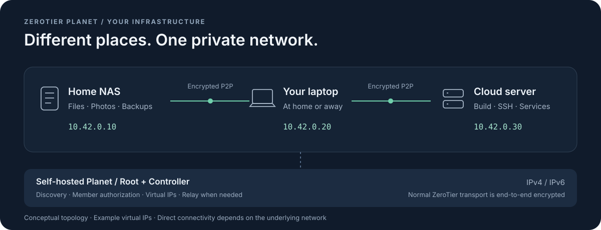
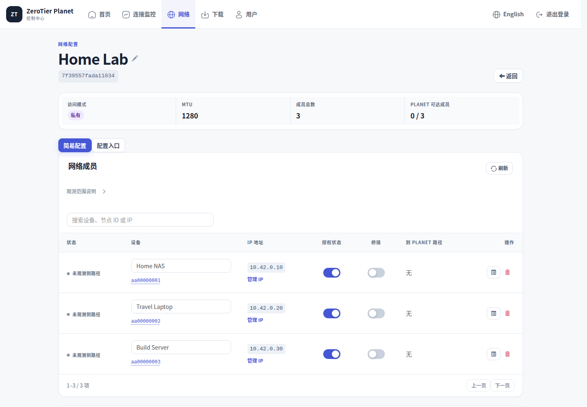

<div align="center">

# zerotier-planet-ms

### 异地的设备，像在同一个局域网。

把家里的 NAS、随身电脑和云服务器连成一张**加密虚拟局域网**。

自建 ZeroTier Planet 与 Controller，在自己的控制台里管理接入、授权和地址。

[](https://github.com/Csneer/zerotier-planet-ms/actions/workflows/image-build.yml) [](https://github.com/Csneer/zerotier-planet-ms/releases)

**[开始部署](#开始部署)** · **[看看控制台](#一张网一个控制台)** · **[方案对比](#选择适合你的组网方式)** · **[运维文档](docs/operations.md)** · **[English](README.en.md)**

</div>

<br>



<br>

## 把内网服务带在身边

出门以后，NAS 仍然是那个 IP；换一张网络，开发机依然可以 SSH；家里的服务和云上的应用，也可以通过同一张私有网络互访。

`zerotier-planet-ms` 面向希望**自己维护 ZeroTier 网络基础设施**的个人、家庭实验室和小团队。设备加入同一网络并获得授权后，就能使用虚拟 IP 访问彼此的服务。NAS 面板、远程桌面、Git、数据库和自建应用，可以继续使用原来的客户端与协议，无需逐个改造成公网服务。

| 你想做什么 | 连上之后 |
| :--- | :--- |
| **在外访问家里的 NAS** | 通过虚拟 IP 打开面板、同步文件，家用宽带无需为每项服务配置公网端口映射。 |
| **随时连接自己的工作站** | 从笔记本访问 SSH、RDP、开发环境；目标设备保持开机，服务监听与防火墙按需放行。 |
| **打通家中、机房与云主机** | 让安装客户端的机器跨地域互联；已有整段内网可进一步规划路由或网关接入。 |
| **搭建自己的小团队内网** | 集中授权设备、分配地址，按网络组织测试服务、协作工具和共享资源。 |

**先连设备，再按需接入网段。** 客户端通常主动建立连接，利用 NAT 穿透争取直连；网络条件不允许时，使用中转路径。直连时，业务数据在设备之间传输，不需要全部绕行云主机。

<br>

## 加密的是连接，掌握在你手里的是网络

**设备间端到端加密。** 在 ZeroTier 的正常加密传输配置下，虚拟网络流量在端点加密、在对端解密，经 Root 中转也保持加密，Root 无法读取业务载荷。加密与身份认证由 [ZeroTier 协议](https://docs.zerotier.com/protocol) 提供，本项目负责把自建根节点、控制器与日常管理整合起来。

**授权和网络配置由你管理。** 在自己的 Controller 创建网络、核对节点 ID、授权设备和管理虚拟地址；Planet 签名材料、服务端身份、配置和备份保存在自己的基础设施上。

**公网入口收敛到组网层。** 自建 Root 提供可达的 UDP 端点，NAS、开发机等设备通过虚拟网络提供服务。无需为了访问每个应用，把它们分别开放到公网。

这里的“加密局域网”指 **ZeroTier 端点之间的虚拟网络**。它不会自动加密网关后面的整个物理局域网，也不替代应用登录、SSH/HTTPS 或主机防火墙。更多协议范围与选型依据见[方案对比](docs/choosing-a-solution.md)。

<br>

## 一张网，一个控制台



<p align="center"><sub>当前 main 界面实拍 · 隔离演示实例与虚构设备 · 不包含真实部署数据</sub></p>

**常用操作留在眼前，细节需要时再看。** 创建网络、授权成员、修改 MTU、下载 Planet，在同一个界面完成。点击成员可以查看版本、IP、授权和观测路径；较长的配置与诊断放进弹窗，页面保持紧凑。

| 日常管理 | 遇到问题时 |
| :--- | :--- |
| 设备别名、成员搜索、分页与授权开关 | 区分服务实例和探针视角的 DIRECT / RELAY 观测 |
| IPv4 / IPv6 地址分配、路由、DNS 与 MTU | 查看 Root 地址族、近期响应和 Planet 文件一致性 |
| 登录后下载 Planet，并核对 SHA-256 | 点击版本、桥接等提示，查看原因与处理步骤 |
| 中英文界面，桌面与手机均可操作 | 一致性备份、受检查的升级与恢复流程 |

监控展示的是**具体观测点的证据**；“到 Root 可达”不等于任意两台设备都已直连。排查时可沿着[客户端与链路指引](docs/client-troubleshooting.md)继续验证。

<br>

## 从一台小云主机开始

**2 vCPU / 2 GiB 可以作为部署起点。** 阿里云等云厂商的小规格 Linux 主机即可用于起步；优先使用预构建镜像，把机器留给运行服务，而非现场编译依赖。

已有隔离容器实测：在 2 vCPU / 2 GiB 限制下完成登录、建网、授权、改名和移动端操作，流程结束时单次内存采样约 **69 MiB**。这证明管理服务可以轻量运行；中转吞吐仍取决于带宽、CPU、路径和并发，详见[可复现的容量记录](docs/capacity-benchmark.md)。

- **IPv4、IPv6、双栈都是正式配置路径。** 每个 Root 至少有一个可达端点；IPv6-only Root 需要客户端与 Controller 具备相应的 IPv6 连通性。
- **需要更多路径时，加入独立 Root。** 统一签名 Planet，Root 与 Controller 可分开部署。多 Root 提供路径冗余，Controller 接管按单活流程进行。
- **数据跟着你走。** identity、网络、授权、Web 账户和签名材料可持久化、备份和迁移，保留自己的网络标识。

[IPv6 Root](docs/ipv6-roots.md) · [多 Root 部署](docs/multi-root.md) · [Controller 迁移与备用](docs/controller-standby.md)

<br>

## 选择适合你的组网方式

这些方案解决的问题有重叠，管理方式和使用重点不同。加密、P2P、自托管都不是本项目独有的能力。

| 方案 | 主要用途 | 适合你的情况 |
| :--- | :--- | :--- |
| **zerotier-planet-ms** | 自建 ZeroTier Planet 与 Web 控制台 | 希望掌握 Root 与网络授权，能维护客户端 Planet。 |
| [Tailscale](https://github.com/tailscale/tailscale) | WireGuard 组网，托管控制面 | 优先考虑省心接入、成熟客户端与身份管理。 |
| [Headscale](https://github.com/juanfont/headscale) | 自托管 Tailscale 协调服务 | 保留 Tailscale 客户端，自行维护控制面与可选社区 UI。 |
| [NetBird](https://github.com/netbirdio/netbird) | WireGuard 组网与 Web 策略管理 | 需要团队接入与集中访问控制，可托管或自托管。 |
| [EasyTier](https://github.com/EasyTier/EasyTier) | 去中心化组网与子网代理 | 希望通过 CLI / GUI / Web 灵活组合节点与网关。 |
| [frp](https://github.com/fatedier/frp) | TCP / UDP / HTTP(S) 服务发布 | 主要需要几个端口或域名服务，也可按需使用 XTCP。 |

自托管范围、加密边界、移动端支持，以及 frp 实验性 VirtualNet 等细节见[完整选型说明](docs/choosing-a-solution.md)。资料核对于 **2026-10-31**。

<br>

## 开始部署

准备一台有固定公网 IPv4 或全球单播 IPv6 的 Linux 主机，以及 **Docker Engine 24+、Compose v2、Bash、Git、Python 3、jq、GNU coreutils**。执行账户需有 Docker 和数据目录权限；为 Root 放行 `9994/udp`，双栈时检查两种地址族的规则。

### 1. 启动服务

下面拉取与本页界面对应、已通过 CI 的主分支构建，避免在小主机上编译。将 `YOUR_PUBLIC_IPV4` 换成真实公网地址：

```bash
git clone https://github.com/Csneer/zerotier-planet-ms.git
cd zerotier-planet-ms
./install.sh --ip YOUR_PUBLIC_IPV4 --data-dir /srv/zerotier-planet \
  --pull --image ghcr.io/csneer/ms-zerotier-planet:sha-7308b49
```

**IPv6-only**：把 `--ip YOUR_PUBLIC_IPV4` 换为 `--ipv6 YOUR_PUBLIC_IPV6`；**双栈**：同时提供两个参数。已有部署先读[原地升级指南](docs/in-place-upgrade.md)，不要重复初始化。

> 镜像选择：`sha-7308b49` 对应本页演示的[已验证提交](https://github.com/Csneer/zerotier-planet-ms/commit/7308b4911edb0f195724aa924053611382c01a02)；最新正式 Release 为 [`v1.2.0`](https://github.com/Csneer/zerotier-planet-ms/releases/tag/v1.2.0)，尚未包含成员弹窗等后续改动。正式部署可进一步固定 digest。完整[版本与镜像规则](docs/releasing.md)。

### 2. 打开自己的控制台

管理台默认监听服务器回环地址。在本机建立 SSH 隧道：

```bash
ssh -N -L 3443:127.0.0.1:3443 user@server
```

打开 **http://127.0.0.1:3443**，使用初始账号 `admin/password` 登录并立即修改密码。端口号 `3443` 不代表默认启用 HTTPS；远程管理使用 SSH 隧道或受信的 TLS 反向代理。

### 3. 接入设备，访问服务

1. 在控制台创建私有网络，配置地址池，记下 Network ID。
2. 从「下载」获取 Planet，核对 SHA-256；桌面 / 服务器停止 ZeroTier 后替换文件再启动，移动端按客户端支持的导入方式处理。
3. 客户端加入该 Network ID，在控制台核对节点 ID 并授权。
4. 获得虚拟 IP 后，访问 NAS 面板、SSH 或远程桌面，验证你真正需要的服务。

[客户端路径与接入](docs/operations.md#客户端配置) · [Android / iOS 说明](docs/choosing-a-solution.md#客户端与移动端) · [交给 Agent 安装](docs/agent-install.md)

<br>

## 长期运行，也有清晰的入口

| 现在要做什么 | 从这里开始 |
| :--- | :--- |
| 配置参数、端口、监控、备份与恢复 | [运维手册](docs/operations.md) / [English](docs/operations.en.md) |
| 让 Agent 代为安装并验收 | [Agent 安装指引](docs/agent-install.md) |
| 接管已有部署，保留网络与身份 | [原地升级](docs/in-place-upgrade.md) |
| 新增 Root、采用原生 systemd 部署 | [Root 接入](docs/root-onboarding.md) / [原生 Root](docs/native-root.md) |
| 请求配置、版本提示、桥接或中转排障 | [客户端与链路排障](docs/client-troubleshooting.md) |
| 了解发布内容、复现验证 | [CHANGELOG](CHANGELOG.md) / [浏览器回归](tests/browser/README.md) |

现有网络和数据优先保留；`upgrade` 会准备镜像、生成一致性备份并等待健康检查。多 Root 不等于 Controller 自动高可用，镜像回退与签名 World 回退也有不同流程，具体操作请遵循对应指南。

## 建立在成熟项目之上

本项目基于 [ZeroTierOne](https://github.com/zerotier/ZeroTierOne)、[ztncui](https://github.com/key-networks/ztncui) 和 [docker-zerotier-planet](https://github.com/xubiaolin/docker-zerotier-planet) 持续维护，重点是 **自建 Planet 的部署、管理体验与可验证运维**。它不是 ZeroTier 官方产品，也不声称重新发明底层网络协议。

管理台应作为高权限内部服务使用，ztncui 上游的维护状态与各组件许可证见[运维手册](docs/operations.md#安全注意事项)及 [NOTICE](NOTICE.md)。历史代码与第三方组件保留各自许可，本仓库不将它们统一重新许可。

如果它帮助你搭起了自己的私有网络，欢迎 [Star](https://github.com/Csneer/zerotier-planet-ms) 或[反馈使用体验](https://github.com/Csneer/zerotier-planet-ms/issues)。提交问题时附上版本、客户端平台和脱敏拓扑即可，请勿上传身份私钥、令牌或备份。
